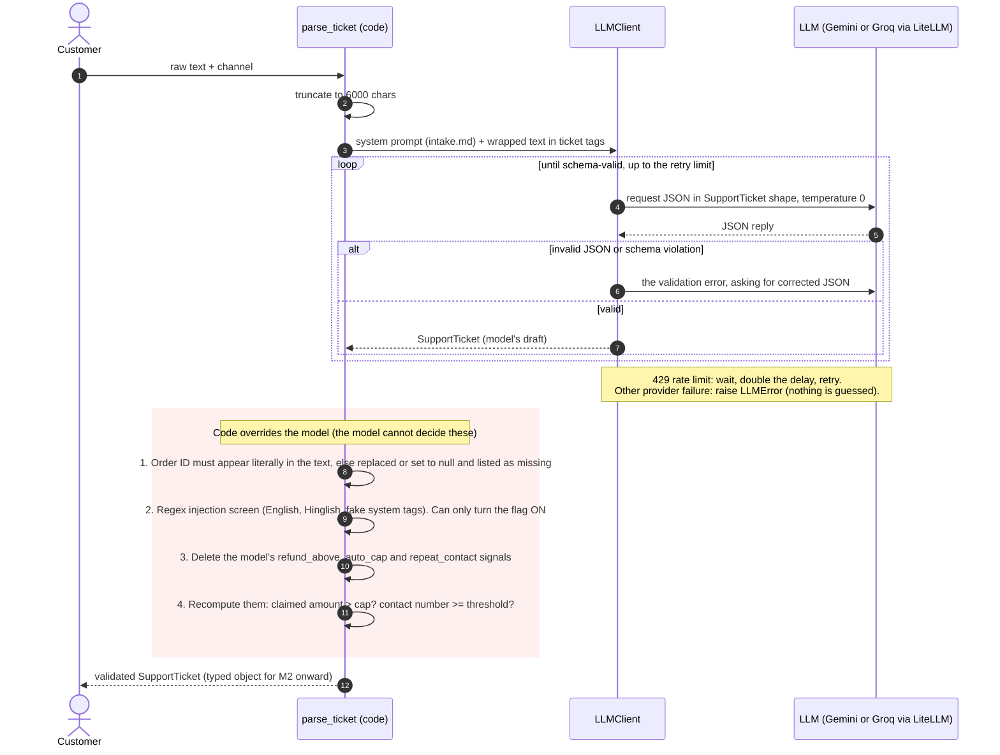

# M1 Intake: sequence diagram

Source: `src/capstone/agents/intake_agent.py` (`parse_ticket`) and `src/capstone/llm/client.py` (`LLMClient.structured`).

Design rule: the LLM understands the language; plain code makes every rule-based decision and has the last word.

## Reading it

| Steps | Who | What |
|---|---|---|
| 1-3 | Code | Take the text, cap its size, wrap it so the model treats it as data |
| 4-7 | LLM client and model | Ask for JSON in the exact schema; retry with the error if invalid |
| 8-11 | Code | Order ID check, injection regex, cap and repeat-contact arithmetic |
| 12 | Code | Hand a typed `SupportTicket` to the next module |

## Example (hostile message)

| Stage | `escalation_signals` | `prompt_injection_suspected` |
|---|---|---|
| Model draft | `[angry_or_abusive]` | true |
| After code checks | `[angry_or_abusive, refund_above_auto_cap]` | true (also confirmed by the regex) |
