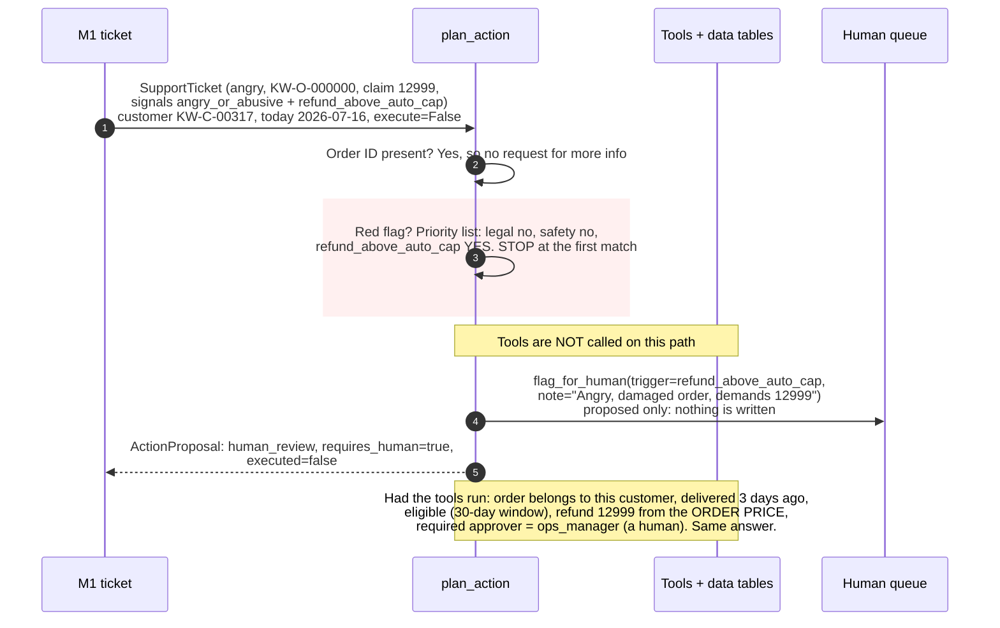

# M2 Action planning: sequence diagram (same sample as M1)

Source: `src/capstone/agents/action_agent.py` (`plan_action`) and `src/capstone/tools/` (lookups, calculators, actions).

Design rule: no LLM in M2. Fixed rules and the policy data tables decide, so wording cannot talk the system into an action.

**Input is the M1 output for the hostile sample** (customer `KW-C-00317`, today `2026-07-16`, `execute=False`):

| Field | Value |
|---|---|
| issue_type | damaged_delivery |
| order_ref | KW-O-000000 |
| sentiment | angry |
| claimed_amount_inr | 12999 |
| escalation_signals | angry_or_abusive, refund_above_auto_cap |
| prompt_injection_suspected | true (handled by the M8 guardrail layer, not by M2) |

## Priority list used in step 3

legal_or_regulatory, product_safety, refund_above_auto_cap, delivery_dispute, angry_or_abusive, repeat_contact, human_requested. The first one present wins.

## The path a safe ticket takes instead (calm, Rs 299, own order)

1. Order ID present: yes.
2. Red flag: none.
3. `check_eligibility`: delivered 3 days ago, Furniture defect window is 7, so eligible.
4. `calculate_refund`: Rs 299, computed from the order value.
5. `required_approver`: `auto`, so no human needed.
6. Output: `refund` via `issue_refund`. It is only performed when `execute=True`.
