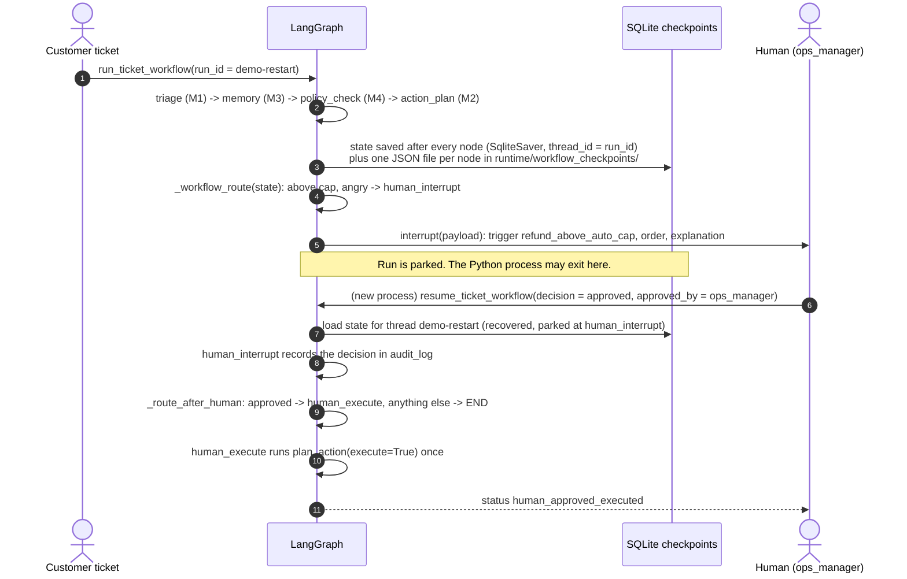
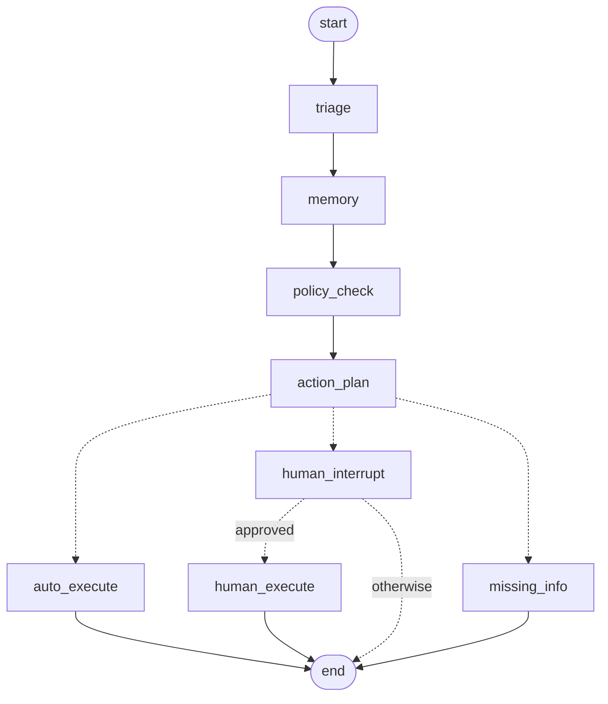

# M5 Workflow: sequence diagram with the same sample

Source: `src/capstone/workflow/graph.py` (`build_workflow`, `run_ticket_workflow`, `resume_ticket_workflow`).

Design rule: the model never routes. A plain function reads state and picks the next node; the human gate is a real `interrupt()`; the irreversible step is its own node after the pause.

**The sample** (real run, Gemini): the hostile ticket from M1, customer KW-C-00317, order KW-O-000000, Rs 12,999, today 2026-07-16, run id `demo-restart`.

## The graph (generated from the compiled object)

## What the real run printed

| Stage | Output |
|---|---|
| First process | interrupt trigger `refund_above_auto_cap`, recommended action `human_review`; checkpoint files `00_triage`, `01_memory`, `02_policy_check`, `03_action_plan` |
| Second process (new Python, same sqlite file) | recovered True, parked at `('human_interrupt',)` |
| After approval | status `human_approved_executed`, `audit_log` = human_decision (approved, by ops_manager, timestamp, note) then action_executed |

## What approval does, honestly

`plan_action(execute=True)` for this ticket runs `flag_for_human`: the case is filed to the human desk. It does **not** issue the Rs 12,999 refund. The human decides the refund after that. Approval means "yes, route it", not "pay it".

## Checked against the Day 3 lab (Lab B)

| Lab item | Here |
|---|---|
| Typed state, reducer on the audit field only | `TicketWorkflowState`, `audit_log: Annotated[list, add]`; control fields are overwritten |
| Routing as pure functions | `_workflow_route`, `_route_after_human`, unit-tested without running the graph |
| Conditional edges | `action_plan` -> 3 routes; `human_interrupt` -> execute or end |
| Loop guard | Not needed: the graph has no cycles. `changes_requested` (loop back to revise) is not implemented |
| Checkpointer + thread_id | `SqliteSaver`, `thread_id = run_id` (UI creates a unique id per run) |
| `interrupt()` + `Command(resume=...)` | `human_interrupt_node`, `resume_ticket_workflow` |
| Approve / reject | approve -> execute; reject -> status `human_rejected`, nothing executes. Edit-then-approve is not implemented (no draft text to edit) |
| Real restart | `test_m5_paused_run_resumes_from_disk_in_a_fresh_process` and a two-process run |
| Nothing irreversible before `interrupt()` | gate node only reads state; `test_m5_approved_action_runs_exactly_once` counts `execute=True` calls (0 before, 1 after) |
| Approver identity in state | `audit_log` stores `by` and `at`; not authenticated here (belongs to the API layer) |
| Strict msgpack | Not set. State is plain JSON types, so it would be safe to enable `LANGGRAPH_STRICT_MSGPACK=true` |

Checks: `pytest tests/unit/test_workflow.py` (6 tests).
