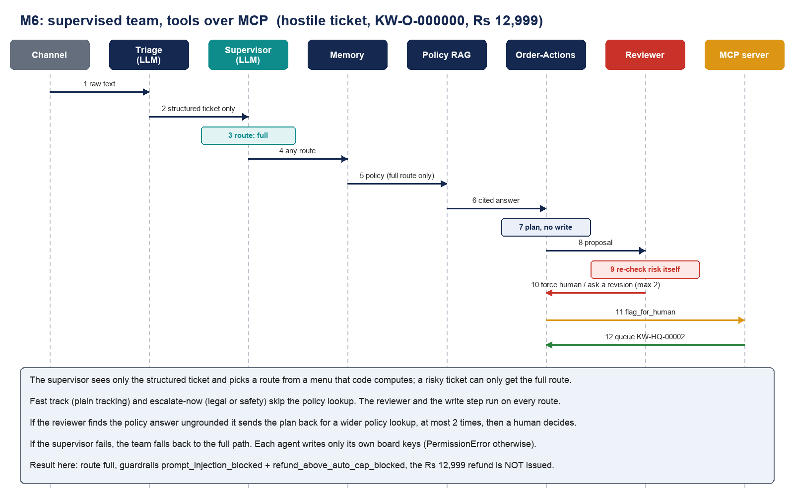
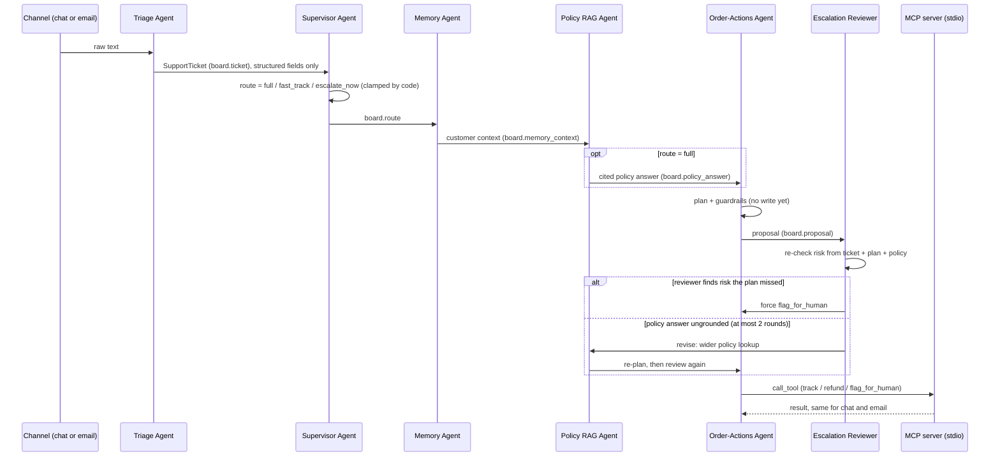

# M6: multi-agent team with an MCP tool server

Sample (same as M1-M5): hostile ticket for order KW-O-000000, customer KW-C-00317, claim Rs 12,999, 2026-07-16.

## Real run, MCP on, execute on

| | chat | email |
|---|---|---|
| stages | Triage, Supervisor (route full), Memory, Policy RAG, Order-Actions, Reviewer | same |
| guardrails | prompt_injection_blocked, refund_above_auto_cap_blocked | same |
| reviewer | human_review (angry_or_abusive) | same |
| tool run | flag_for_human over MCP, queue KW-HQ-00002 | same tool, same queue id, `duplicate: true` |
| Rs 12,999 refund | not issued | not issued |

## Three tickets, three routes (live Gemini, MCP on and off)

| Ticket | Route chosen | Policy lookup | Outcome |
|---|---|---|---|
| Hostile, Rs 12,999 | full (the only route code allows for it) | runs | flag_for_human, reviewer human_review |
| "Where is KW-O-000010?" | fast_track | skipped | track_shipment, reviewer auto_resolve |
| Consumer-court threat | escalate_now | skipped | flag_for_human, reviewer human_review |

## Checked against the Day 3 Session 2 lab

| Lab item | Here |
|---|---|
| Write permission enforced per agent | `AGENT_SCOPES` + `commit()` raises `PermissionError`; tested |
| Critic independent of producer | Reviewer re-derives risk from ticket, plan, policy; can only tighten; tested |
| Model may route, not authorise | The reviewer is deterministic code; no model can waive a human check |
| Write only after the critic | Order-Actions plans, reviewer answers, then the write tool runs; tested |
| MCP server with tools and a resource | 10 tools + `shopsense://policy/tool-rules`; tested over stdio |
| No delete / arbitrary-write tool | asserted in a test; writes are idempotent refund / replacement / human queue |
| Customer-scoped access over the protocol | wrong customer refused over MCP; tested |
| Same tools for chat and email | same queue id on both channels |
| Supervisor with LLM routing | Built (`team/supervisor.py`). The LLM sees only the structured ticket and picks from a menu that code computes; an off-menu or failed answer falls back to the full path; tested |
| Legal route | `escalate_now` is offered only for legal_or_regulatory or product_safety tickets; skips the policy lookup and goes to a human; tested |
| Revision loop with a cap | Reviewer sends an ungrounded policy answer back for a wider lookup, at most 2 rounds, then a human decides; tested both ways |
| Supervisor cannot skip safety | The reviewer and the write step run after every route, forced by code; the lab's full "supervisor star" (a manager that can call any agent in any order) is not copied |
| Only some agents use a model | Triage and the Supervisor call an LLM; the other four are deterministic code |
| All tools via the gateway / MCP | Yes: eligibility, refund amount, approver tier, tracking and the final write all go through the gateway (`plan_action(..., gateway=)`); tested with a spy |
| MCP in the API | `CAPSTONE_TOOL_TRANSPORT=mcp` makes `/chat` use the MCP server; default stays in-process (faster, no child process) |
| A2A / AP2 appendix | Not applicable to this problem |
