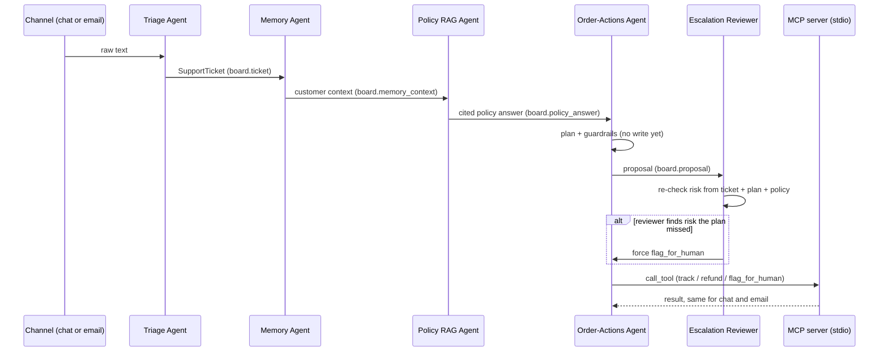

# M6: multi-agent team with an MCP tool server

Sample (same as M1-M5): hostile ticket for order KW-O-000000, customer KW-C-00317, claim Rs 12,999, 2026-07-16.

## Real run, MCP on, execute on

| | chat | email |
|---|---|---|
| stages | Triage, Memory, Policy RAG, Order-Actions, Reviewer | same |
| guardrails | prompt_injection_blocked, refund_above_auto_cap_blocked | same |
| reviewer | human_review (angry_or_abusive) | same |
| tool run | flag_for_human over MCP, queue KW-HQ-00002 | same tool, same queue id, `duplicate: true` |
| Rs 12,999 refund | not issued | not issued |

## Checked against the Day 3 Session 2 lab

| Lab item | Here |
|---|---|
| Write permission enforced per agent | `AGENT_SCOPES` + `commit()` raises `PermissionError`; tested |
| Critic independent of producer | Reviewer re-derives risk from ticket, plan, policy; can only tighten; tested |
| Model may route, not authorise | The reviewer is deterministic code; no model can waive a human check |
| Write only after the critic | Order-Actions plans, reviewer answers, then the write tool runs; tested |
| MCP server with tools and a resource | 10 tools + `shopsense://policy/tool-rules`; tested over stdio |
| No delete / arbitrary-write tool | asserted in a test; writes are idempotent refund / replacement / human queue |
| Customer-scoped access over the protocol | wrong customer refused over MCP; tested |
| Same tools for chat and email | same queue id on both channels |
| Supervisor with LLM routing, legal routes, revision loop | **Not built.** Our team is a fixed five-stage line, not a supervisor star. No loop-back, so no revision cap is needed. |
| Only some agents use a model | Only Triage calls an LLM; the rest are deterministic code |
| All tools via the gateway / MCP | Yes: eligibility, refund amount, approver tier, tracking and the final write all go through the gateway (`plan_action(..., gateway=)`); tested with a spy |
| MCP in the API | `CAPSTONE_TOOL_TRANSPORT=mcp` makes `/chat` use the MCP server; default stays in-process (faster, no child process) |
| A2A / AP2 appendix | Not applicable to this problem |
