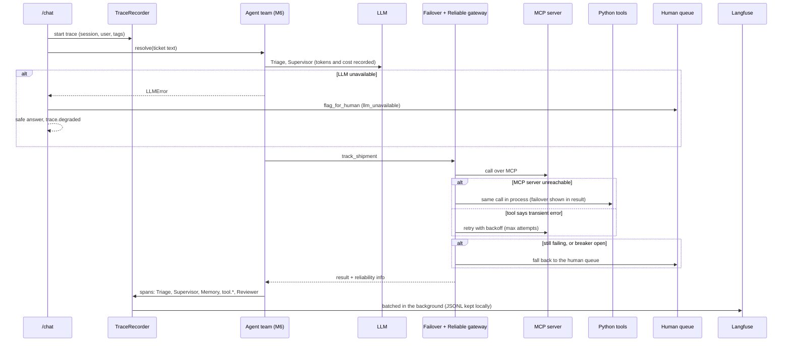

# M7: tracing and reliability around one ticket

Sample (same ticket B as the deck): "Hi, where is my order KW-O-000010?", customer KW-C-00194, 2025-10-10.

## Circuit breaker states

closed, then open after N failures; after the cooldown it goes half-open and lets exactly one trial call through. Success closes it, failure re-opens it at once.

## Real run (live Gemini, MCP default)

| Check | Result |
|---|---|
| Default transport | mcp; `track_shipment` ran over MCP |
| Langfuse | 7 observations in one trace; Triage and Supervisor are GENERATION spans with model, tokens, cost |
| Triage | 730 input / 128 output tokens, about $0.00054 |
| Supervisor | 287 input / 46 output tokens, about $0.00020 |
| MCP server cannot start | same call ran in process, `failover.to = python`, ticket still resolved |
| LLM unavailable | `/chat` returned 200, `escalation_review.reason = llm_unavailable`, case queued (KW-HQ-00003) |
| Seeded benchmark (seed 42, 200 calls) | baseline 114 clean (57%); hardened 179 clean + 21 to the human queue = 100% handled |
| Breaker on a dead dependency (10 calls, threshold 3) | 3 reached the dependency, 7 short-circuited |
| Tracing overhead | untraced 9.9 ms; local JSONL +0.6 ms; JSONL + Langfuse +1.5 ms per ticket |

Finding worth saying out loud: flushing Langfuse after every ticket added about 200 ms to each request. It is now batched in the background.

## Checked against the Day 4 Session 1 lab

| Lab item | Here |
|---|---|
| A1 span for each agent, errors still recorded | `TraceRun.span` closes on exception and records the error; tested |
| A1b nested span for retrieval and tools | policy retrieval and `tool.*` are child spans |
| A2 session / user id and tags | `session_id`, `user_id`, `tags` on every trace |
| A3 per-agent latency, cost table | `summarize_trace`: calls, total, avg, errors, fallbacks, tokens, cost |
| A4 traced vs untraced timing | `scripts/run_tracing_overhead.py` |
| A5 generation spans with tokens and cost | Triage and Supervisor, verified in Langfuse |
| B1 seeded baseline | 114 / 200 clean, 57% (same as the lab) |
| B2 retries with backoff, transient only | `ReliableToolGateway`; malformed data is not retried |
| B3 fallback | to the human queue, visible in `reliability.fallback`; 179 + 21 as in the lab |
| B4 circuit breaker with half-open | one trial call; 3 real calls, 7 short-circuited |
| Problem statement: fallback to human queue | tool failures and an LLM outage both end in the queue |
